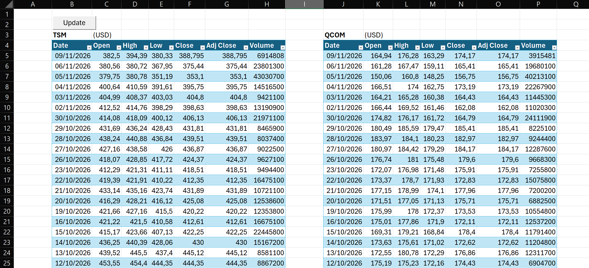
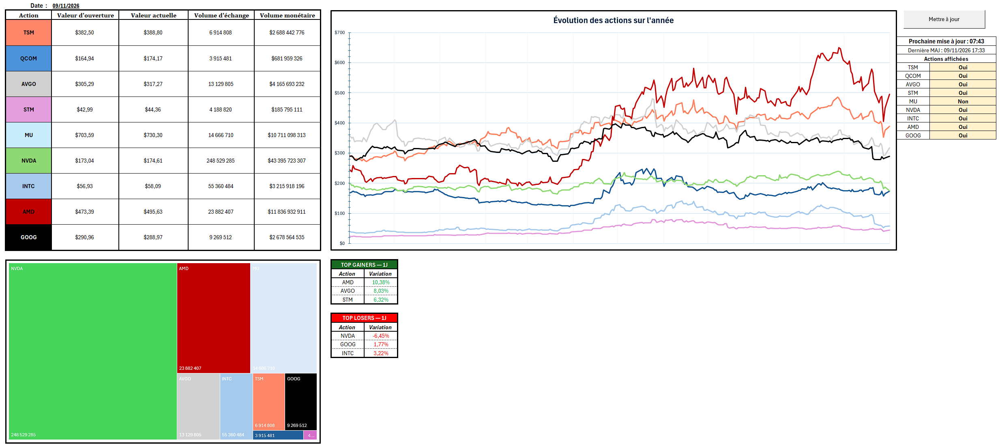
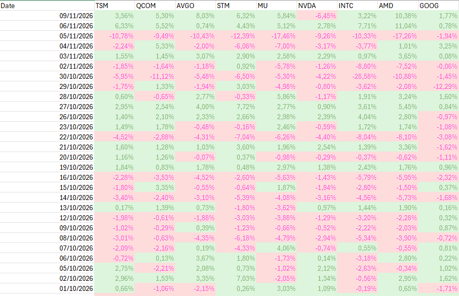
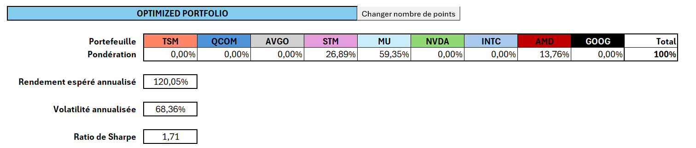
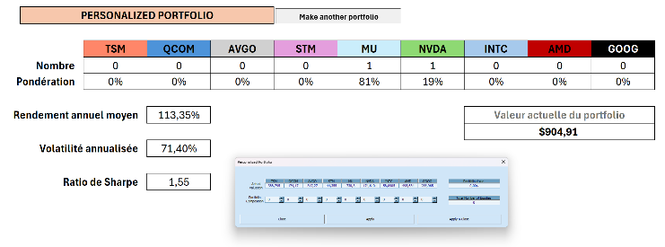
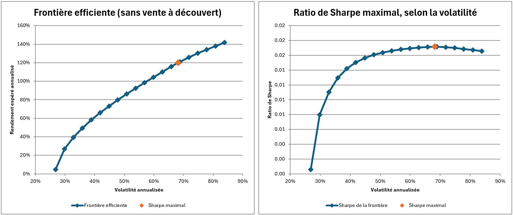
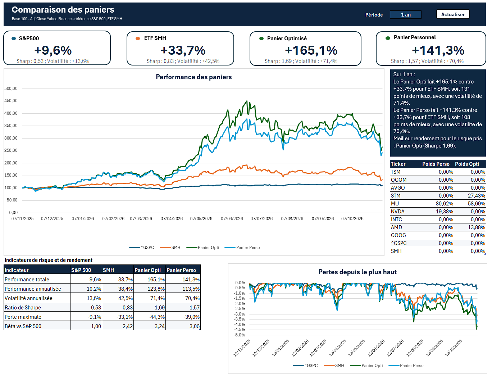
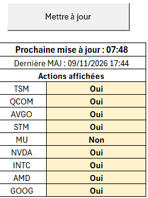

## 1. Introduction

This project is an Excel/VBA tool that builds and tracks, almost in real time, a portfolio of technology and semiconductor stocks based on Markowitz's theory. It covers nine stocks (TSM, QCOM, AVGO, STM, MU, NVDA, INTC, AMD, GOOG), benchmarked against the S&P 500 (^GSPC) and the SMH sector ETF. Prices come from Yahoo Finance; the tool derives returns from them, searches for the weights that maximize the Sharpe ratio, plots the efficient frontier, then compares the optimized portfolio with a personal portfolio and with the indices.

The workbook has four visible sheets and four hidden calculation sheets, driven by seven VBA modules and one input form. Everything is triggered from the "Mettre à jour" (Update) button on the Dashboard, or automatically every 10 minutes.

| Sheet | Role | VBA code |
|---|---|---|
| Data (hidden) | Yahoo Finance histories of the 11 tickers | HistoryYahooFin |
| Rendements (hidden) | Daily returns, means, covariances | Module1_CalculRendement |
| Optimized Portfolio | Optimal weights, indicators, frontier charts | Module2_Portfolio, Module3_Frontiere |
| Personalized Portfolio | The user's personalized portfolio | UserForm Personalized_Portfolio |
| Dashboard | Overview, update button, timer | Personalized_Portfolio_Button, Module5_Minuteur |
| Comparaison | Indices and sector baskets, risk indicators | Module4_Comparaison |
| Frontiere, Info (hidden) | Frontier points; risk-free rate (3 %), chart series | – |

## 2. Data import

The `HistoryYahooFin` module queries the public Yahoo Finance API (`query1.finance.yahoo.com/v8/finance/chart/<ticker>?range=...&interval=1d`) using the `MSXML2.ServerXMLHTTP` object. The JSON response is parsed by a custom function (no external library) that extracts dates, open, high, low, close, adjusted close and volume.

- Each ticker occupies an 8-column block of the Data sheet, sorted from most recent to oldest, and becomes an Excel table named `tbl_<ticker>`; a one-second pause separates the requests.
- `ImportHistory` asks for the period (1d to max, 1 year by default); `ImportHistoryPeriode` does the same job without asking anything: it is the one called by the update and by the Comparaison sheet.
- All calculations use the adjusted close (Adj Close), which accounts for dividends and stock splits. The sheet is cleared and rebuilt on every import: formulas in the other sheets therefore point to fixed cells rather than structured references.

## 3. Dashboard

The Dashboard summarizes the market at the most recent available date (cell C2 = maximum of the dates in the Data sheet).

- Left table: opening value, current value, volume and monetary volume (volume × price) of each stock, read with INDEX/MATCH on the reference date, so it is unaffected by updates.
- "Évolution des actions sur l'année" chart (evolution of the stocks over the year): one line per stock, in the color of its cell in the table. Nine Yes/No (Oui/Non) drop-down lists choose which stocks are displayed: a hidden sheet returns the price if "Oui" and #N/A if "Non", which hides the line without touching the chart.
- Treemap of monetary volume, and Top Gainers / Top Losers tables over 1 day (LARGE / SMALL functions on the daily change, with ties broken by row number).

## 4. Returns and optimized portfolio

The `CalculRendement` module computes, for each stock, the simple daily returns on the adjusted close (250 observations for one year), their mean, variance and volatility, and the 9 × 9 covariance matrix (Rendements sheet). The Optimized Portfolio sheet then derives, for weights w normalized to 100 %:

*Return = Σ wᵢ·μᵢ × 252    Volatility = √(wᵀ Σ w × 252)*

*Sharpe = (Return − r_f) / Volatility    with r_f = 3 %*

These cells are real formulas, which the Excel Solver (GRG Nonlinear) varies: it maximizes the Sharpe ratio under the constraints Σw = 1 and 0 ≤ w ≤ 1, with no short selling. A row of normalized weights keeps the model correct even if the Solver does not respect Σw = 1 exactly.

The Personalized Portfolio sheet applies the same indicators to the real portfolio: a form (+/− buttons) enters the number of shares of each stock, and the weights are computed by value (number × price / total value).

## 5. Efficient frontier

The `FrontiereEfficiente` macro computes, for a series of volatility ceilings, the maximum return attainable with no short selling.

- Minimum volatility: the Solver minimizes volatility (first point of the curve).
- Maximum return: computed directly as the best single asset taken alone, which avoids a Solver failure on this edge case (last point).
- Intermediate points: the user chooses the number of points (an integer from 10 to 100, 20 by default); the ceilings are evenly spread between these two volatilities and the Solver maximizes the return under each ceiling.
- A final calculation gives the maximum-Sharpe portfolio, displayed in the top table of Optimized Portfolio.

The points (volatility, return, Sharpe, weights, Solver return code) are stored in the hidden Frontiere sheet. Two charts are placed in Optimized Portfolio: the Markowitz frontier and the "Ratio de Sharpe maximal, selon la volatilité" (maximum Sharpe ratio as a function of volatility).

## 6. Comparison

The "Actualiser" (Refresh) button asks for a period (5d, 1mo, 3mo, 6mo, ytd or 1y: one year at most), re-imports the data, then runs `Base100`, `panier`, `Indicateurs`, `PertesMax` and `Conclusion` (an automatically generated summary text).

The Opti basket and the Perso basket are constant-weight baskets, rebalanced every day: the day's return is the sum of the weights × the stocks' returns. This is the same assumption as Markowitz's. The Opti weights come from Optimized Portfolio, the Perso weights from Personalized Portfolio. The indicators therefore use the same definitions as the Portfolio sheets (annualized return = daily mean × 252, Sharpe with r_f = 3 %): a test on the workbook's data gives differences below 10⁻¹⁵ between the two calculations.

## 7. Timer and automatic update

The full update (`MettreToutAJour`) chains the 1-year import, the returns calculation, the Solver for maximum Sharpe and the frontier, then brings the user back to the sheet they were on. The `Module5_Minuteur` module triggers it on its own:

- a 10-minute countdown, refreshed every second by `Application.OnTime`, is displayed under the "Mettre à jour" button; a manual click resets it to 10:00;
- at zero, the update runs without any message or question (the number of frontier points is the last one chosen); if the user is working in another workbook, it waits and retries 10 seconds later;
- `Auto_Open` starts the timer when the workbook opens and runs a first update after 5 seconds; `Auto_Close` cancels the scheduled task on close;
- the date, hour and minute of the last successful update are written under the timer. The Comparaison sheet, however, is only recalculated by its own "Actualiser" button.

